# Plan2Model

**Ảnh chụp bản vẽ mặt bằng giấy → bản vẽ CAD (DXF) → mô hình 3D, bằng xử lý ảnh cổ điển (OpenCV).**
Dự án nhóm môn **Xử lý Ảnh và Video số**, MSE – FPT University.

<p align="center">
  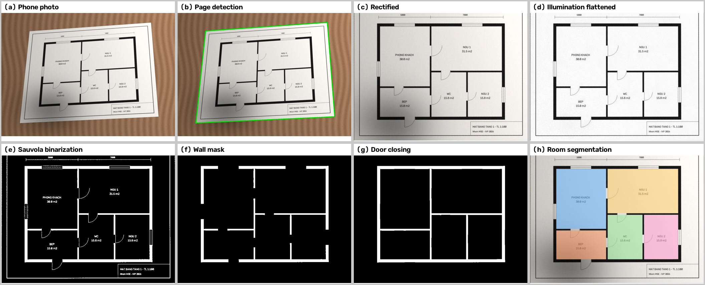
</p>
<p align="center"><em>Từ ảnh chụp điện thoại (a) qua tìm tờ giấy, nắn phối cảnh, làm phẳng sáng, nhị phân hoá Sauvola, lấy tường, đóng cửa, đến tách phòng (h).</em></p>

<p align="center">
  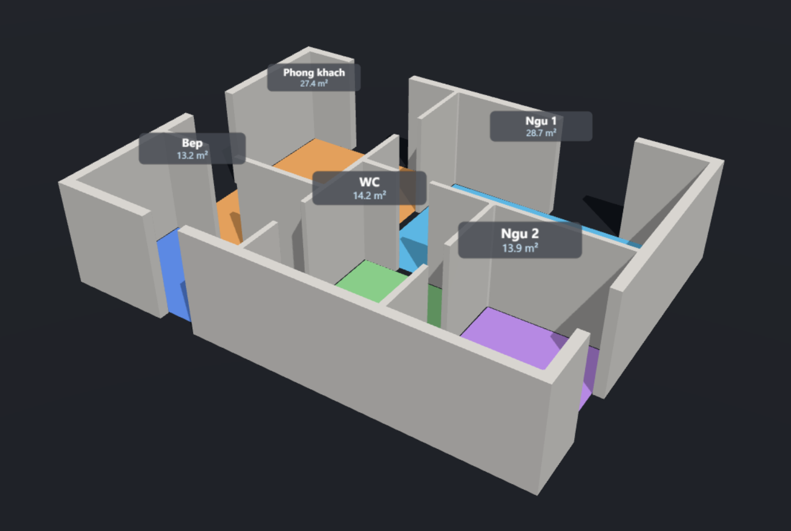
</p>
<p align="center"><em>Mô hình 3D dựng tự động từ bản vẽ trên, kèm tên phòng và diện tích.</em></p>

| | |
|---|---|
| Báo cáo | [`report/Plan2Model_Report.pdf`](report/Plan2Model_Report.pdf) (bản Word: `report/Plan2Model_Report.docx`) |
| Video demo | [Release v1.0 → `Plan2Model_video.mp4`](https://github.com/nstung463/plan2model/releases/tag/v1.0) (8:47) |
| Dataset | [Release v1.0 → `plan2model_dataset.zip`](https://github.com/nstung463/plan2model/releases/download/v1.0/plan2model_dataset.zip) (157 MB, 405 ảnh CubiCasa5K có nhãn + ảnh tổng hợp) |
| Trọng số U-Net | [Release v1.0 → `unet_wall.pt`](https://github.com/nstung463/plan2model/releases/tag/v1.0) |
| Kết quả chi tiết | [`prototype/RESULTS.md`](prototype/RESULTS.md) |

## Thành viên

| Thành viên | MSHV | Phần việc chính |
|---|---|---|
| Nguyễn Thu Trang | | |
| Nguyễn Văn Thụ | | |
| Nguyễn Sơn Tùng | 26ms23347 | |
| Nguyễn Hoàng Khôi Minh | 26ms23356 | |

## Phương pháp

<p align="center">
  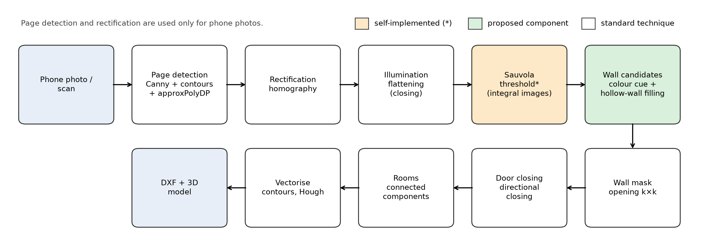
</p>

- **Tự cài đặt (ô cam):** ngưỡng Sauvola dùng ảnh tích phân (`prototype/pipeline.py`). Kết quả khớp `skimage.filters.threshold_sauvola` ở 99,99 % điểm ảnh.
- **Đề xuất của nhóm (ô xanh):** dùng thêm màu sắc và **lấp tường rỗng**, để xử lý cả 3 kiểu vẽ tường: tô đặc, vẽ viền, gạch chéo/tô màu.
- **Các kỹ thuật chuẩn:** Canny, contour + Douglas–Peucker, homography, hình thái học, biến đổi khoảng cách, thành phần liên thông, Hough.

**Vì sao cần lấp tường rỗng:** tường vẽ bằng hai nét viền sẽ bị phép mở (opening) xoá sạch (c). Khi lấp lòng tường trước (d), phép mở giữ lại được tường (e).

<p align="center">
  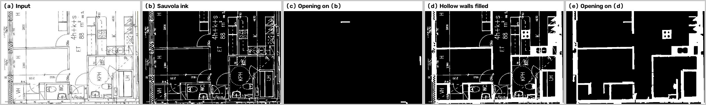
</p>

## Demo: ứng dụng Streamlit

<table>
  <tr>
    <td width="50%">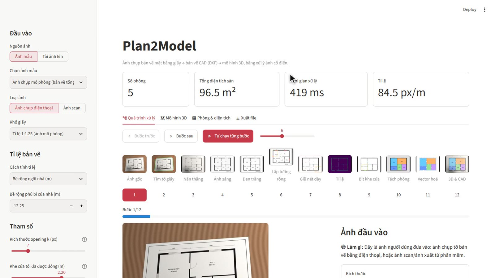</td>
    <td width="50%">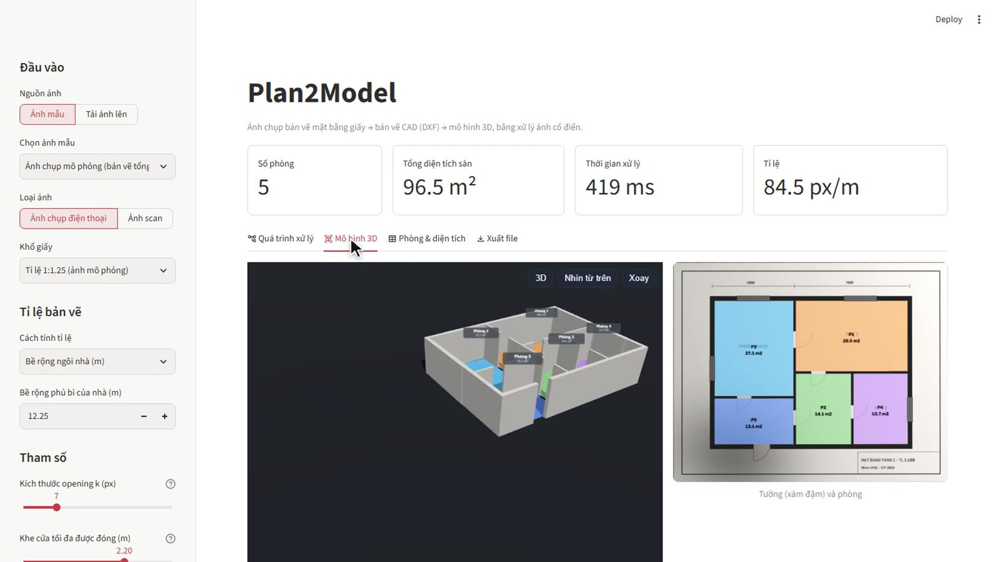</td>
  </tr>
  <tr>
    <td><em>Tab “Quá trình xử lý”: số phòng, diện tích, thời gian; bấm từng bước để xem ảnh trung gian.</em></td>
    <td><em>Tab “Mô hình 3D”: xoay, zoom, nhìn từ trên; bên phải là tường và phòng trên ảnh gốc.</em></td>
  </tr>
  <tr>
    <td>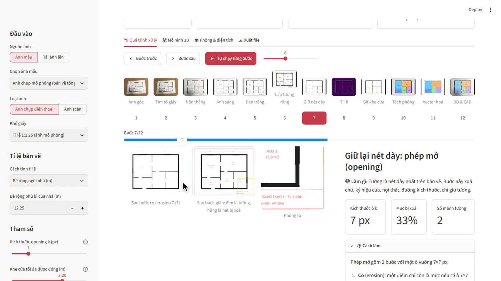</td>
    <td>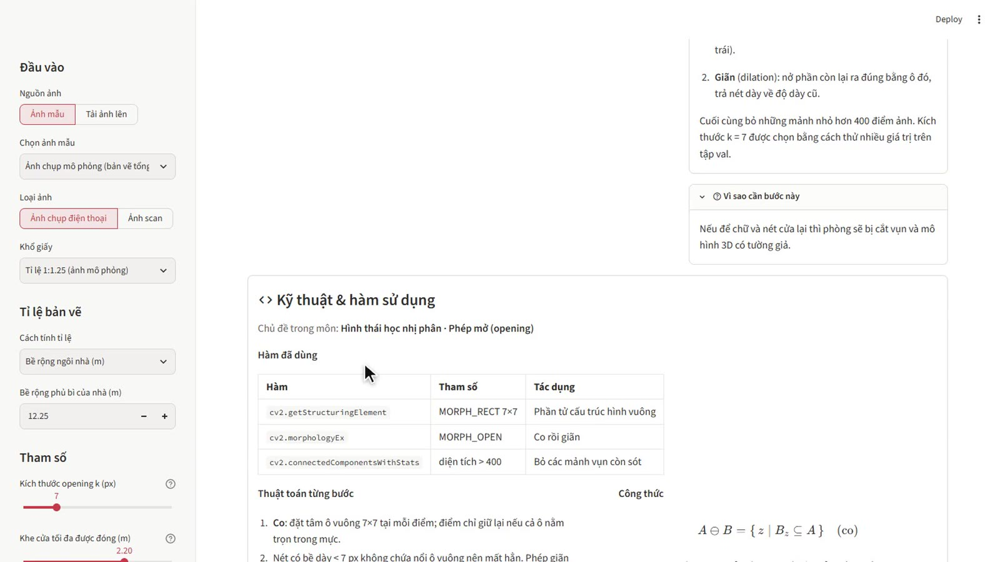</td>
  </tr>
  <tr>
    <td><em>Mỗi bước có ảnh trước/sau và số liệu của bước đó (ví dụ phép mở 7×7).</em></td>
    <td><em>Khung “Kỹ thuật &amp; hàm sử dụng”: tên hàm OpenCV, tham số, công thức.</em></td>
  </tr>
  <tr>
    <td>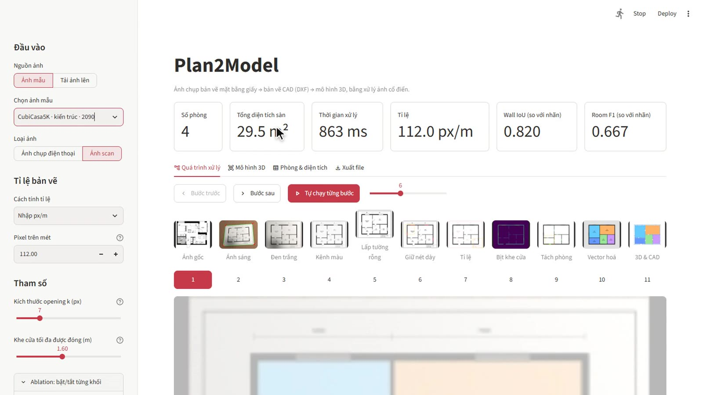</td>
    <td>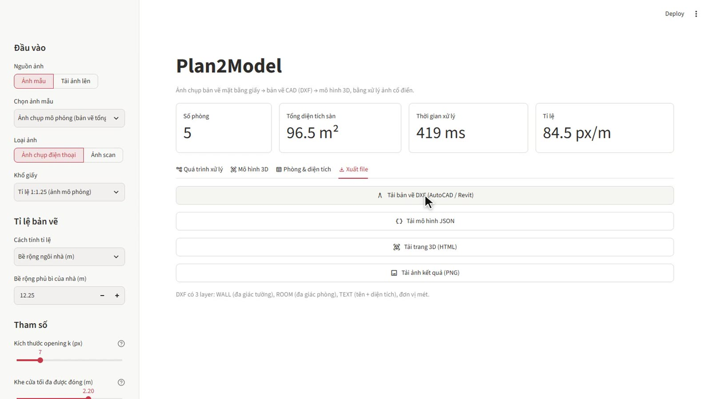</td>
  </tr>
  <tr>
    <td><em>Ảnh CubiCasa5K: app chấm luôn Wall IoU và Room F1 so với nhãn. Có thể bật/tắt từng khối để xem ablation trực tiếp.</em></td>
    <td><em>Tab “Xuất file”: tải DXF (mở bằng AutoCAD/Revit), JSON, trang 3D HTML, ảnh kết quả.</em></td>
  </tr>
</table>

## Kết quả chính (CubiCasa5K test, 60 ảnh)

Tham số được tune trên tập val rồi giữ nguyên khi chạy test.

| Phương pháp | Wall IoU | Room F1 |
|---|---|---|
| Baseline Otsu (tune trên val) | 0.473 | 0.316 |
| Baseline Sauvola v1 (tune trên val) | 0.421 | 0.304 |
| **Đề xuất (k = 7)** | **0.560** | **0.454** |
| U-Net ResNet-18 (học sâu, để so sánh) | 0.774 | 0.565 |

<p align="center">
  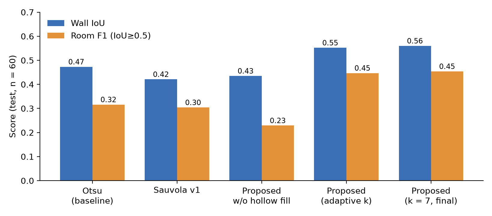
</p>

- **Ablation:** bỏ khối lấp tường rỗng thì Room F1 giảm từ 0.447 xuống 0.229. Đây là khối đóng góp lớn nhất.
- **Kiểm định bootstrap (5000 lần):**
  - So với Otsu, phương pháp đề xuất hơn +0.080 Wall IoU, khoảng tin cậy 95 % là [+0.030, +0.134].
  - U-Net hơn phương pháp đề xuất +0.214 Wall IoU. Đổi lại U-Net cần 300 ảnh có nhãn và 2,5 giờ train.

**Ảnh dự đoán:** xanh lá là tường đúng, đỏ là tường thừa, xanh dương là tường bị sót. Ba ảnh là ca tốt nhất, ca trung vị và ca tệ nhất:

<p align="center">
  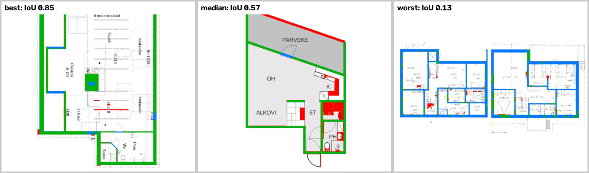
</p>

## Cài đặt

Python ≥ 3.9.

```bash
pip install -r requirements.txt
```

## Chạy demo

```bash
streamlit run app.py
```

- Mở `http://localhost:8501`. App có sẵn ảnh chụp mô phỏng, có thể tải ảnh của mình lên.
- Ảnh mẫu CubiCasa5K chỉ hiện sau khi tải dữ liệu (xem mục Dữ liệu).
- Muốn bật tuỳ chọn U-Net trong app thì tải `unet_wall.pt` ở Release, đặt vào `prototype/models/`.

Chạy bằng dòng lệnh (không cần giao diện):

```bash
python prototype/run_demo.py   # ảnh mô phỏng → prototype/output/floorplan.dxf, model.json, demo.html
```

## Dữ liệu

**Cách 1, tải bộ dữ liệu nhóm đã dùng:** tải [`plan2model_dataset.zip`](https://github.com/nstung463/plan2model/releases/download/v1.0/plan2model_dataset.zip) rồi giải nén vào `prototype/data/`.

| Phần | Số ảnh | Dùng để |
|---|---|---|
| `cubicasa/val` | 45 (15 ảnh/nhóm) | tune tham số |
| `cubicasa/test` | 60 (20 ảnh/nhóm) | đánh giá, giữ nguyên tham số |
| `cubicasa/train` | 300 | chỉ để train U-Net so sánh |
| `photo.jpg`, `plan_clean.png`, `gt_wall.png` | 1 bộ | ảnh tổng hợp do nhóm tự sinh (`prototype/synth.py`) |

- Mỗi ảnh CubiCasa gồm `F1_scaled.png` (ảnh bản vẽ) và `model.svg` (nhãn tường và phòng).
- Nguồn: CubiCasa5K (Kalervo và cộng sự, SCIA 2019), [zenodo.org/records/2613548](https://zenodo.org/records/2613548), giấy phép CC BY-NC 4.0.

**Cách 2, tự tải lại từ nguồn gốc:** script tải từng phần (HTTP range, ~60 MB) theo split chính thức:

```bash
python prototype/fetch_cubicasa.py val 45
python prototype/fetch_cubicasa.py test 60
python prototype/fetch_cubicasa.py train 300   # chỉ cần để train U-Net
```

## Tái lập kết quả

| Bước | Lệnh |
|---|---|
| Tune tham số trên val | `python prototype/tune.py` → `prototype/params.json` |
| Đánh giá trên test (baseline, đề xuất, ablation, bootstrap) | `python prototype/eval_cubicasa.py test` |
| U-Net (CPU) | `python prototype/unet_wall.py train 3000`, rồi `python prototype/eval_unet.py` |
| Hình cho báo cáo | `python prototype/make_figures.py` |
| Dựng báo cáo Word | `python report/build_report.py` |
| Xuất PDF (điền mục lục) | `"C:Program Filesibreofficeprogrampython.exe" report/export_pdf.py` |

## Cấu trúc

```
app.py                       demo Streamlit
requirements.txt
prototype/
  pipeline.py                các bước xử lý ảnh (Sauvola tự cài, lấp tường rỗng, tách phòng…)
  core.py                    lõi dùng chung cho app: xử lý, xuất DXF/JSON/3D
  synth.py                   sinh bản vẽ tổng hợp + giả lập ảnh chụp điện thoại
  cubicasa_gt.py             đọc nhãn SVG của CubiCasa5K
  fetch_cubicasa.py          tải dữ liệu
  tune.py, eval_cubicasa.py  tune trên val, đánh giá trên test
  unet_wall.py, eval_unet.py U-Net để so sánh
  explain.py, tech.py        nội dung giải thích từng bước cho app
  params.json                tham số đã đóng băng
  output/                    kết quả: bảng, hình dự đoán, DXF/3D mẫu
report/                      báo cáo (docx, pdf), script dựng báo cáo, hình
docs/images/                 ảnh chụp app dùng trong README
video/                       kịch bản và mã dựng video demo (HyperFrames)
```

## Khai báo sử dụng AI

Nhóm dùng Claude (Anthropic) qua Claude Code để hỗ trợ viết và sửa mã, gợi ý thiết kế thí nghiệm, soạn báo cáo và dựng video.
Chi tiết ở Phụ lục C của báo cáo.
